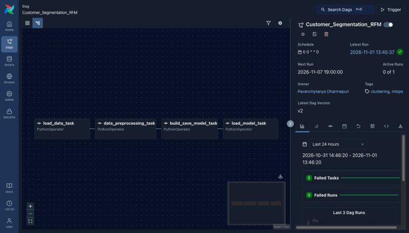
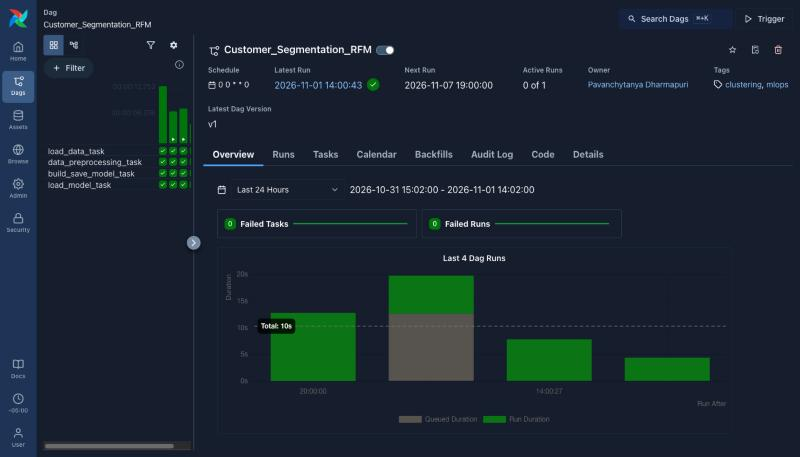

# Customer Segmentation with Airflow: MLOps Airflow Lab

This lab uses Apache Airflow to run a customer segmentation pipeline. A DAG of
four tasks loads a year of online store orders, builds recency, frequency and
monetary (RFM) features for each customer, picks the number of clusters with the
elbow method, trains a K-Means model and labels each segment. Airflow runs in
Docker Compose and the DAG is scheduled weekly.

> **Lab Assignment 3 submission.** Adapted from
> [Airflow_Labs/Lab_1](https://github.com/raminmohammadi/MLOps/tree/main/Labs/Airflow_Labs/Lab_1)
> in the [raminmohammadi/MLOps](https://github.com/raminmohammadi/MLOps) course
> repository. The structure is the same (one DAG, four PythonOperator tasks that
> pass data through XCom, K-Means with the elbow method, Airflow in Docker Compose),
> and the dataset, features, model selection and outputs are new. See
> [My Modifications](#my-modifications).

---

## Dataset

The [Online Retail dataset](https://archive.ics.uci.edu/dataset/352/online+retail)
from the UCI Machine Learning Repository. It is not used in any of the course labs.

- 541,909 transactions from a UK online gift store between December 2010 and
  December 2011, with invoice number, product, quantity, price, date, customer ID
  and country.
- Cleaning removes rows with no customer ID (135,080), cancelled invoices (invoice
  numbers starting with `C`), rows with zero or negative quantity or price, and
  exact duplicates. 392,692 transactions from 4,338 customers remain.
- Each customer gets three features:
  - **recency_days:** days since their last order, counted from the day after the
    last invoice in the data
  - **frequency:** number of separate orders
  - **monetary:** total amount spent (quantity x unit price)

The data is stored in `dags/data/online_retail.csv.gz` (converted from the original
Excel file). `dags/data/test.csv` has three new customers to segment.

License: CC BY 4.0. Chen, D. (2015). Online Retail. UCI Machine Learning Repository.
https://doi.org/10.24432/C5BW33

---

## My Modifications

The original lab clusters a credit card dataset on three columns, saves the last
model it fits (k=49), and prints the elbow value without using it. In this version:

- **Problem and dataset:** customer segmentation on 541,909 retail transactions
  instead of clustering pre-made credit card columns. The first task now turns raw
  orders into one row per customer.
- **Features:** RFM features built from the transactions. They are very skewed (the
  top customer spent £280,206, the median £669), so they are log-transformed before
  scaling.
- **Preprocessing:** the log + standard scaling pipeline is fitted on the train
  customers only and saved as `preprocessor.pkl`, so new customers in `test.csv`
  are scaled the same way before prediction.
- **Holdout check:** customers are split 80/20. The model is trained on 3,470
  customers and the silhouette score is compared on the 868 holdout customers.
- **Model selection:** K-Means is fitted for k = 2 to 10. The elbow of the SSE curve
  (found with `kneed`) picks k, the model is refit with that k and saved. If the curve
  has no clear elbow, the k with the best silhouette score is used.
- **Segment labels:** each cluster is described by its median recency, frequency and
  spend and its share of total revenue, ranked from most to least valuable, and given
  a plain name (Top customers, Loyal, At risk, New or occasional, Lost).
- **Outputs:** the last task writes `segment_report.json` (scores for every k, chosen
  k, silhouette scores, segment profiles, test predictions) and
  `customer_segments.csv` (the segment for every customer) to `working_data/`.
- **DAG:** scheduled `@weekly` instead of manual only, one retry per task,
  `max_active_runs=1` so two runs never write the same output files at once, and tags.
  The DAG file is named `customer_segmentation.py`, because a file named `airflow.py`
  in the dags folder hides the real `airflow` package when Python imports it.
- **Docker:**
  - The official Airflow 3.3.2 `docker-compose.yaml` is included, with example DAGs
    turned off and a `working_data` volume for the outputs.
  - A small `Dockerfile` extends the Airflow image with `kneed` instead of
    installing packages each time a container starts.
  - `setup.sh` creates the folders and `.env`, builds the image and initializes
    the database.
- **Tests:** pytest tests for the cleaning, RFM features, segment names, the full
  four-task pipeline on the real data, and the DAG structure. A GitHub Actions
  workflow runs them on every push.

---

## How the Pipeline Works

The DAG is defined in `dags/customer_segmentation.py`. Each task is a
`PythonOperator` that calls one function from `dags/src/lab.py`. A function's return
value is stored by Airflow as an XCom, and the next task receives it through
`<task>.output` in `op_args`:

```python
data_preprocessing_task = PythonOperator(
    task_id='data_preprocessing_task',
    python_callable=data_preprocessing,
    op_args=[load_data_task.output],
)

load_data_task >> data_preprocessing_task >> build_save_model_task >> load_model_task
```

XCom stores JSON, so DataFrames and arrays are pickled and base64-encoded into a
string (`to_b64` / `from_b64` in `lab.py`). Only the customer table (4,338 rows)
goes through XCom, never the 541,909 raw transactions. Files that later tasks or
people need (model, preprocessor, reports) are written to `working_data/`.

| Task | Function | Receives | What it does | Returns (XCom) | Writes |
|---|---|---|---|---|---|
| `load_data_task` | `load_data()` | nothing | Reads `online_retail.csv.gz`, removes bad rows, builds recency, frequency and monetary per customer | customer RFM table | |
| `data_preprocessing_task` | `data_preprocessing(data)` | RFM table | Splits customers 80/20, fits log + standard scaling on the train customers | scaled train and holdout arrays | `preprocessor.pkl`, `customers_rfm.csv` |
| `build_save_model_task` | `build_save_model(data, "model.sav")` | scaled arrays | Fits K-Means for k = 2 to 10, picks k with the elbow method, refits and saves | SSE and silhouette for every k, chosen k | `model.sav` |
| `load_model_task` | `load_model_elbow("model.sav", scores)` | scores from the previous task | Assigns every customer a segment, checks the holdout silhouette, names the segments, predicts `test.csv` | segment names for the test customers | `segment_report.json`, `customer_segments.csv` |

DAG settings:

| Setting | Value | Why |
|---|---|---|
| `dag_id` | `Customer_Segmentation_RFM` | Name shown in the UI |
| `schedule` | `@weekly` | Refresh the segments as new orders come in |
| `start_date` | 2026-10-01 | |
| `catchup` | `False` | Only run the latest week, not every week since the start date |
| `max_active_runs` | 1 | Runs write the same files in `working_data/`, so one at a time |
| `retries` / `retry_delay` | 1 / 2 minutes | Retry a failed task once |

---

## Results

The elbow of the SSE curve is at **k = 5**.

| k | 2 | 3 | 4 | **5** | 6 | 7 | 8 | 9 | 10 |
|---|---|---|---|---|---|---|---|---|---|
| SSE | 5,186 | 3,911 | 3,176 | **2,692** | 2,320 | 2,076 | 1,907 | 1,762 | 1,635 |
| Silhouette | 0.434 | 0.338 | 0.336 | **0.310** | 0.309 | 0.305 | 0.295 | 0.277 | 0.275 |

k = 2 has the highest silhouette score, but it only separates active customers from
inactive ones. k = 5 gives segments a store could act on, and its silhouette score
is about the same as k = 3 to 7.

The silhouette score is 0.310 on the train customers and 0.314 on the holdout
customers, so the segments hold up on customers the model has not seen.

| Segment | Customers | Days since last order (median) | Orders (median) | Spend (median) | Share of revenue |
|---|---|---|---|---|---|
| Top customers | 396 (9.1%) | 7 | 14 | £5,577 | 55.2% |
| Loyal | 953 (22.0%) | 16 | 5 | £1,699 | 21.9% |
| At risk | 1,013 (23.4%) | 85 | 3 | £965 | 16.0% |
| New or occasional | 851 (19.6%) | 25 | 1 | £342 | 3.6% |
| Lost | 1,125 (25.9%) | 217 | 1 | £234 | 3.3% |

- 9% of customers bring in 55% of the revenue.
- The At risk group has ordered a few times (median 3) but not for almost three
  months. It holds 16% of revenue, so it is the obvious target for a win-back email.
- About a quarter of customers (Lost) ordered once, a median of 7 months ago.

New customers from `test.csv`:

| Days since last order | Orders | Spend | Segment |
|---|---|---|---|
| 3 | 25 | £9,000 | Top customers |
| 40 | 4 | £1,200 | At risk |
| 200 | 1 | £150 | Lost |



---

## Project Structure

```
.
├── docker-compose.yaml         # official Airflow 3.3.2 compose file, adapted
├── Dockerfile                  # Airflow image + kneed
├── setup.sh                    # folders, .env, build, database init
├── requirements.txt            # packages added to the Airflow image
├── requirements-dev.txt        # requirements + pandas and pytest for local tests
├── pytest.ini
├── dags/
│   ├── customer_segmentation.py   # the DAG
│   ├── src/lab.py                 # the four task functions
│   └── data/
│       ├── online_retail.csv.gz
│       └── test.csv
├── tests/
│   ├── test_lab.py             # cleaning, features, segment names, full pipeline
│   └── test_dag.py             # DAG loads, task order, settings (needs Airflow)
├── assets/                     # Airflow UI screenshots
└── .github/workflows/tests.yml # runs the tests on every push
```

`logs/`, `config/`, `plugins/` and `working_data/` are created by `setup.sh` and
filled by Airflow.

---

## Airflow Services

`docker-compose.yaml` is the official Airflow 3.3.2 file with the CeleryExecutor.
`docker compose up` starts these containers:

| Service | Role |
|---|---|
| `postgres` | Metadata database: DAG runs, task states, users, XComs |
| `redis` | Message broker that passes tasks from the scheduler to the workers |
| `airflow-apiserver` | Web UI and REST API on http://localhost:8080 |
| `airflow-scheduler` | Decides which tasks are ready to run and queues them |
| `airflow-dag-processor` | Reads the files in `dags/` and turns them into DAGs |
| `airflow-worker` | Runs the task code (the functions in `lab.py`) |
| `airflow-triggerer` | Handles deferrable tasks that wait on outside events |
| `airflow-init` | Runs once: creates the database tables and the `airflow` admin user |
| `airflow-cli` | Optional, for running `airflow` commands (only starts with `--profile debug` or `docker compose run`) |
| `flower` | Optional Celery monitoring UI on port 5555 (only starts with `--profile flower`) |

All Airflow containers mount `dags/`, `logs/`, `config/`, `plugins/` and
`working_data/` from this folder, so edits to the DAG are picked up without a
rebuild and the outputs appear on your machine.

---

## How to Run

### Prerequisites

- Docker Desktop (or Docker Engine with the compose plugin), running.
- At least 4 GB of memory for Docker (8 GB is better). To check how much Docker has:

    ```sh
    docker run --rm "debian:bookworm-slim" bash -c 'numfmt --to iec $(echo $(($(getconf _PHYS_PAGES) * $(getconf PAGE_SIZE))))'
    ```

- Port 8080 free.

### Step 1: Get the code

```sh
git clone https://github.com/PavanchytanyaD/mlops-airflow-customer-segmentation-lab.git
cd mlops-airflow-customer-segmentation-lab
```

### Step 2: Set up

```sh
./setup.sh
```

This stops any earlier run and removes its volumes, creates `logs/`, `plugins/`,
`config/` and `working_data/`, writes your user ID to `.env` (so files Airflow
creates are owned by you), builds the image from the `Dockerfile`, and runs
`airflow-init` to set up the database and the admin user. The first build downloads
the Airflow image and takes a few minutes.

### Step 3: Start Airflow

```sh
docker compose up -d
```

Wait until every service shows `(healthy)`, usually 1 to 2 minutes:

```sh
docker compose ps
```

### Step 4: Open the web UI

Go to http://localhost:8080 and sign in with username `airflow` and password
`airflow`. `Customer_Segmentation_RFM` is in the Dags list, paused.

### Step 5: Run the DAG

Turn on the toggle next to `Customer_Segmentation_RFM`. Because the DAG is scheduled
weekly with `catchup=False`, Airflow starts one run for the latest week right away.
To start another run at any time, click **Trigger**.

The same from the command line:

```sh
docker compose exec airflow-scheduler airflow dags unpause Customer_Segmentation_RFM
docker compose exec airflow-scheduler airflow dags trigger Customer_Segmentation_RFM
```

A run takes about 20 seconds.

### Step 6: Follow the run

- **Grid** view: one column per run, one square per task (green means success).
- **Graph** view: the four tasks and their dependencies (screenshot above).
- Click a task, then **Logs**. The `load_model_task` log prints the chosen k, the
  silhouette scores, the segment table and the test predictions.

From the command line:

```sh
docker compose exec airflow-scheduler airflow dags list-runs Customer_Segmentation_RFM
docker compose exec airflow-scheduler airflow tasks states-for-dag-run Customer_Segmentation_RFM <run_id>
```

Task logs are also saved on your machine under
`logs/dag_id=Customer_Segmentation_RFM/run_id=<run_id>/task_id=<task>/`.



### Step 7: Look at the results

| File in `working_data/` | Contents |
|---|---|
| `segment_report.json` | SSE and silhouette for every k, chosen k, train and holdout silhouette, segment profiles, test predictions |
| `customer_segments.csv` | Every customer with recency, frequency, monetary, train or holdout, cluster and segment name |
| `customers_rfm.csv` | The RFM table written by the preprocessing task |
| `model.sav` | The trained K-Means model |
| `preprocessor.pkl` | The fitted log + standard scaling pipeline |

### Step 8: Stop Airflow

```sh
docker compose down       # stop the containers, keep the database
docker compose down -v    # stop and also delete the database volume
```

### Run the DAG once without the scheduler

`dag.test()` runs all four tasks in one process, which is handy while changing the
code. With the containers running:

```sh
docker compose exec airflow-scheduler python /opt/airflow/dags/customer_segmentation.py
```

---

## Troubleshooting

- **Port 8080 is already in use:** stop the other program, or change `"8080:8080"`
  under `airflow-apiserver` in `docker-compose.yaml` to another port such as
  `"8081:8080"`.
- **Containers keep restarting or exit with code 137:** Docker is out of memory.
  Give it more in Docker Desktop under Settings, Resources.
- **The DAG is not in the list:** check for errors with
  `docker compose exec airflow-scheduler airflow dags list-import-errors`. Airflow
  looks for new files in `dags/` every 5 minutes, so a new DAG can take that long to
  show up.
- **Permission errors on `logs/` or `working_data/` (Linux):** make sure `.env`
  contains `AIRFLOW_UID` with your user ID. `setup.sh` writes it.
- **Warning that `FERNET_KEY` is not set:** expected for a local setup. It is only
  needed to encrypt connection passwords and variables stored in Airflow.

---

## Running the Tests

```sh
pip install -r requirements-dev.txt
pytest
```

The tests check the data cleaning, the RFM features, the segment names, the full
four-task pipeline on the real data (outputs, scores, holdout silhouette and test
predictions), and the DAG structure. The DAG tests need Airflow, so they are skipped
outside the container. To run every test inside the Airflow image:

```sh
docker compose run --rm -v "$PWD":/repo --entrypoint bash airflow-cli \
  -c "pip install -q pytest && cd /repo && python -m pytest -p no:cacheprovider"
```
